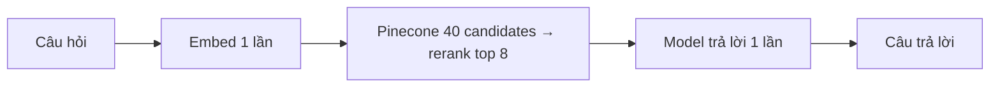
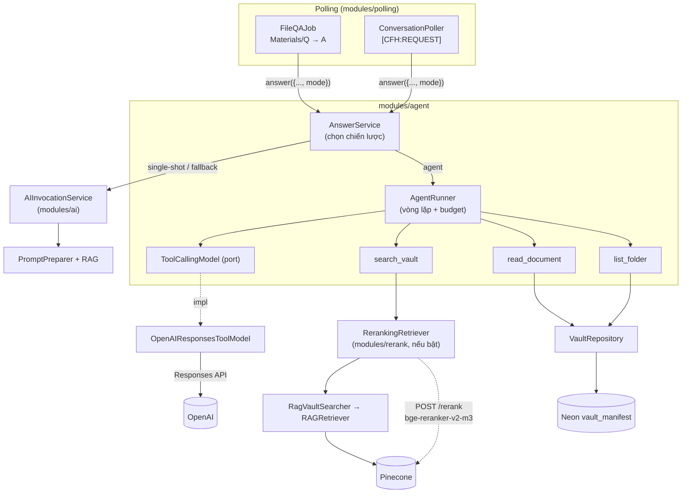
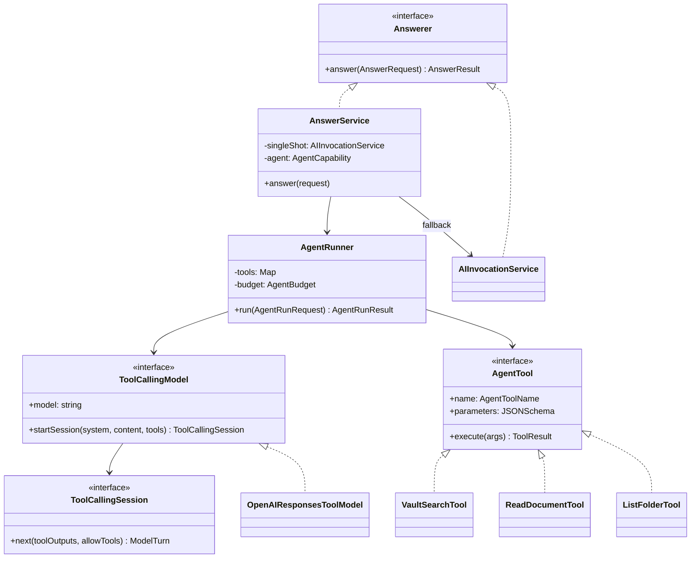
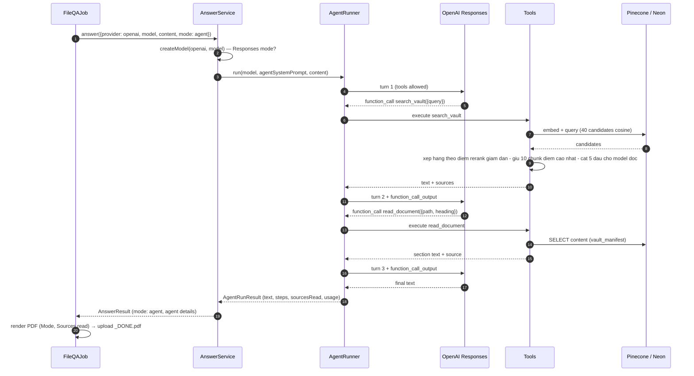
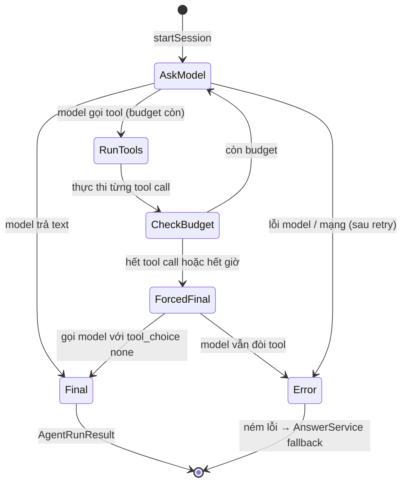
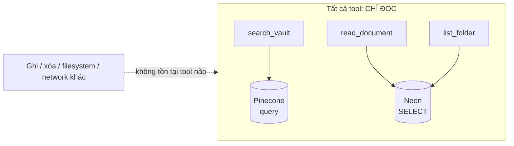
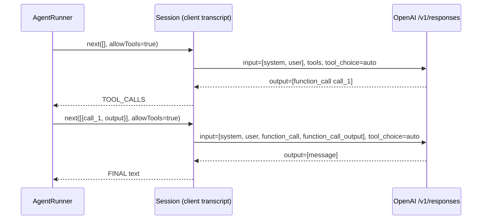
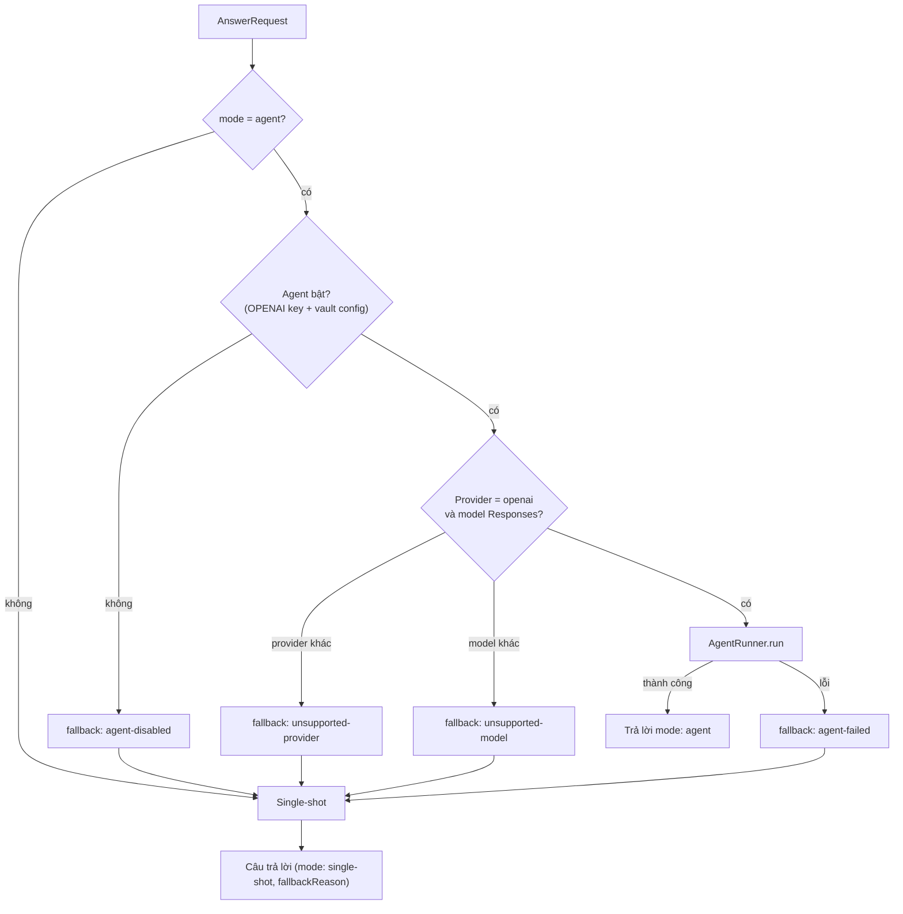
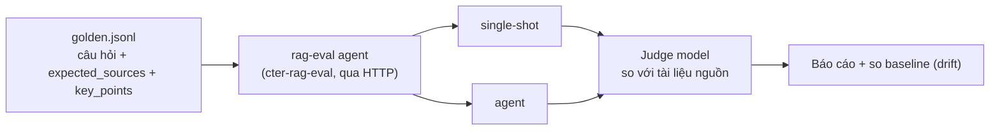

# Agentic RAG — Tài liệu từ A đến Z

> Chế độ **agent** của `cter-ai-harness-service`: model được dùng các tool chỉ-đọc để tự nghiên cứu vault tài liệu môn học trước khi trả lời.
> Code: `src/modules/agent/` · Đánh giá: `cter-rag-eval` (repo riêng, gọi service qua HTTP) · Kế hoạch gốc: kiến trúc MVP, provider OpenAI, kích hoạt opt-in.

## Mục lục

1. [Tóm tắt nhanh](#1-tóm-tắt-nhanh)
2. [Vì sao cần agent](#2-vì-sao-cần-agent)
3. [Thuật ngữ](#3-thuật-ngữ)
4. [Cách bật chế độ agent](#4-cách-bật-chế-độ-agent)
5. [Kiến trúc tổng thể](#5-kiến-trúc-tổng-thể)
6. [Cấu trúc module (DDD 4 lớp)](#6-cấu-trúc-module-ddd-4-lớp)
7. [Luồng xử lý một request](#7-luồng-xử-lý-một-request)
8. [Vòng lặp agent và ngân sách](#8-vòng-lặp-agent-và-ngân-sách)
9. [Bộ tool](#9-bộ-tool)
10. [Prompt của agent](#10-prompt-của-agent)
11. [Adapter OpenAI Responses](#11-adapter-openai-responses)
12. [Fallback — không bao giờ mất câu trả lời](#12-fallback--không-bao-giờ-mất-câu-trả-lời)
13. [Kết quả trả về người dùng](#13-kết-quả-trả-về-người-dùng)
14. [Cấu hình](#14-cấu-hình)
15. [Quan sát & log](#15-quan-sát--log)
16. [An toàn](#16-an-toàn)
17. [Kiểm thử](#17-kiểm-thử)
18. [Đánh giá chất lượng (eval)](#18-đánh-giá-chất-lượng-eval)
19. [Giới hạn hiện tại & lộ trình](#19-giới-hạn-hiện-tại--lộ-trình)
20. [FAQ](#20-faq)
21. [Phụ lục: bản đồ file](#21-phụ-lục-bản-đồ-file)

---

## 1. Tóm tắt nhanh

| Câu hỏi | Trả lời |
|---|---|
| Agent là gì? | Một vòng lặp *model → gọi tool → nhận kết quả → model…* cho tới khi model trả lời |
| Khác gì cách thường? | Thường: tìm 1 lần (40 candidates → rerank top 8) rồi trả lời. Agent: tìm nhiều lần, viết lại truy vấn, đọc nguyên section rồi mới trả lời |
| Bật thế nào? | File `START_<tên>_openai[_<model>]_agent.<ext>` hoặc header chat `mode: agent` |
| Provider | OpenAI, model chế độ **Responses API** (`gpt-6-astra`, `*codex`) |
| Tool | `search_vault`, `read_document`, `list_folder` — **tất cả chỉ đọc** |
| Giới hạn | ≤ 6 tool call, ≤ 180 s mỗi câu hỏi (cấu hình được) |
| Rerank | `search_vault` đi qua reranker khi `RERANK_PROVIDER=pinecone`: fetch 40 candidates cosine → cross-encoder `bge-reranker-v2-m3` chấm điểm → xếp hạng theo `rerankScore` giảm dần, giữ 10 chunk điểm cao nhất → tool cắt 5 chunk đầu cho model đọc; lỗi rerank → fallback thứ tự cosine |
| Lỗi thì sao? | Tự **fallback** về cách trả lời thường — không mất câu trả lời |
| Mặc định | **Tắt** — request không opt-in vẫn single-shot như cũ |

---

## 2. Vì sao cần agent

Cách trả lời **single-shot** hiện tại:



Các điểm yếu quan sát được trong code và vault:

| Vấn đề | Hệ quả | Agent xử lý |
|---|---|---|
| Câu hỏi tiếng Anh, vault phần lớn **tiếng Việt** | Truy xuất trượt | Model viết lại truy vấn bằng ngôn ngữ còn lại + reranker đa ngôn ngữ (`bge-reranker-v2-m3`) |
| Câu hỏi đề thi **nhiều ý** | 1 lần tìm không phủ hết | Tách ý, tìm riêng từng ý |
| Cosine xếp sai thứ tự (Hit@1 chỉ 69,7%) | Chunk đúng bị chìm | Rerank cross-encoder: 40 candidates → top 10 (Hit@1 → 90,9%) |
| `KnowledgeIndexer` chỉ tách theo `##` → file chỉ có `###` bị cắt vụn | Thiếu ngữ cảnh | `read_document` đọc nguyên section theo heading |
| References có thể trích file chưa dùng | Trích dẫn sai | Prompt chỉ cho trích file **tool đã trả về** |

Đánh đổi: agent **chậm hơn và đắt hơn** (2–7 lần gọi model). Vì vậy nó là **opt-in**, không bật mặc định.

---

## 3. Thuật ngữ

| Thuật ngữ | Nghĩa trong hệ thống |
|---|---|
| **Single-shot** | Cách trả lời cũ: `PromptPreparer` + `AIInvocationService`, 1 lần retrieve, 1 lần gọi model (có retry/fallback model) |
| **Agent mode** | Trả lời qua `AgentRunner` với tool-calling |
| **Tool** | Hàm chỉ-đọc mà model được phép gọi (`AgentTool`) |
| **Tool call** | Một lần model yêu cầu chạy tool — đơn vị tính ngân sách |
| **Model call / turn** | Một lần gọi API model (`ToolCallingSession.next`) |
| **Budget** | Giới hạn cứng: số tool call, thời gian, độ dài kết quả tool |
| **Forced final** | Lượt cuối gọi model với `tool_choice: none` để buộc trả lời khi hết ngân sách |
| **Fallback** | Chuyển request agent sang single-shot khi agent không dùng được / lỗi |
| **Sources read** | Các file vault mà tool đã thực sự cho model xem — nguồn duy nhất được trích |
| **Vault** | Kho tài liệu `.md` của môn học (Neon `vault_manifest` + vector trong Pinecone) |

---

## 4. Cách bật chế độ agent

### 4.1 Luồng file (Canvas `Materials/Q`)

Thêm hậu tố `_agent` **ngay trước phần mở rộng**:

| Tên file | Mode | Model | File kết quả |
|---|---|---|---|
| `START_bai1_openai.txt` | single-shot | mặc định | `START_bai1_openai_DONE.pdf` |
| `START_bai1_openai_agent.txt` | **agent** | mặc định (`DEFAULT_MODEL_OPENAI`) | `START_bai1_openai_agent_DONE.pdf` |
| `START_bai1_openai_gpt-6-astra_agent.docx` | **agent** | `gpt-6-astra` | `START_bai1_openai_gpt-6-astra_agent_DONE.pdf` |
| `START_bai1_openai_AGENT.md` | **agent** (không phân biệt hoa/thường) | mặc định | `START_bai1_openai_AGENT_DONE.pdf` |
| `START_agent_notes_gemini.txt` | single-shot (`_agent` không đứng trước đuôi) | mặc định | `START_agent_notes_gemini_DONE.pdf` |
| `START_bai1_gemini_agent.txt` | agent → **fallback** (provider chưa hỗ trợ) | mặc định | `START_bai1_gemini_agent_DONE.pdf` |

Parse tại `src/modules/fileqa/domain/startFileName.ts` → trường `ParsedFileName.mode`.

### 4.2 Luồng chat (Canvas Conversations `[CFH:REQUEST]`)

```text
[CFH:REQUEST]
provider: openai
model: gpt-6-astra
mode: agent

Compare mutex and semaphore in QNX.
```

- `mode: agent` (không phân biệt hoa/thường) → agent; thiếu hoặc giá trị khác → single-shot.
- Parse tại `src/modules/conversation/domain/conversationMessage.ts` → `ParsedConversationRequest.mode`.

---

## 5. Kiến trúc tổng thể



Nguyên tắc thiết kế:

| Nguyên tắc | Cách hiện thực |
|---|---|
| Không phá luồng cũ | Job phụ thuộc interface `Answerer`; `AIInvocationService` vẫn thỏa mãn interface này |
| Opt-in | `mode` mặc định `single-shot` |
| Luôn có câu trả lời | Mọi lỗi agent → fallback single-shot |
| Provider có thể thay | `ToolCallingModel` là port; MVP chỉ có OpenAI |
| Chỉ đọc | Tool không có tác dụng phụ, không đọc filesystem |
| Có giới hạn | `AgentBudget` kiểm soát số bước và thời gian |
| Rerank là tối ưu hoá | `search_vault` bọc `RAGRetriever` bằng `RerankingRetriever` (`src/modules/rerank`); mọi lỗi rerank (429/5xx/timeout/rỗng) → fallback thứ tự cosine, agent vẫn chạy tiếp |

---

## 6. Cấu trúc module (DDD 4 lớp)

```text
src/modules/agent/
├── domain/                     ← không phụ thuộc framework
│   ├── agent.enums.ts          AnswerMode, AgentStopReason, AgentToolName, AgentFallbackReason, ModelTurnKind
│   ├── agentTool.ts            AgentTool, ToolResult, AgentToolDefinition
│   ├── agentBudget.ts          AgentBudget, DEFAULT_AGENT_BUDGET, truncateToolOutput
│   ├── agentRun.ts             AgentStep, AgentRunResult, TokenUsage
│   ├── toolCallingModel.port.ts ToolCallingModel, ToolCallingSession, ModelTurn
│   └── answer.ts               Answerer, AnswerRequest, AnswerResult
├── application/                ← điều phối
│   ├── agentRunner.service.ts  vòng lặp agent
│   ├── answer.service.ts       chọn single-shot / agent + fallback
│   └── agentPrompt.ts          system prompt bổ sung cho agent
├── infrastructure/             ← kết nối bên ngoài
│   ├── openaiResponsesToolModel.ts
│   ├── ragVaultSearcher.ts
│   └── tools/ vaultSearch.tool.ts · readDocument.tool.ts · listFolder.tool.ts
└── index.ts                    createAgentModule() — composition
```

| Lớp | Trách nhiệm | Phụ thuộc được phép |
|---|---|---|
| domain | Kiểu dữ liệu, enum, port, quy tắc thuần (cắt độ dài, cộng usage) | Không gì ngoài type |
| application | Vòng lặp agent, chọn chiến lược, prompt | domain, `modules/ai` (qua interface) |
| infrastructure | OpenAI SDK, Pinecone (qua `RAGRetriever`), vault repository | domain, `src/rag`, `modules/vault` |
| index.ts | Lắp ráp module từ `AppConfig` | tất cả lớp trên |

Quan hệ các kiểu chính:



---

## 7. Luồng xử lý một request

Ví dụ file `START_q_openai_agent.txt`, model tìm 1 lần, đọc 1 section rồi trả lời:



Luồng chat giống hệt, chỉ khác bước cuối: `ConversationPoller` gửi `[CFH:REPLY]` có thêm header `mode: agent`.

---

## 8. Vòng lặp agent và ngân sách



### 8.1 Ngân sách (`AgentBudget`)

| Trường | Mặc định | Env | Ý nghĩa |
|---|---|---|---|
| `maxToolCalls` | 6 | `AGENT_MAX_TOOL_CALLS` | Số tool call tối đa mỗi câu hỏi |
| `maxDurationMs` | 180 000 | `AGENT_MAX_DURATION_MS` | Thời gian tối đa cả vòng (agent chạy trong một poll tick) |
| `maxToolResultChars` | 6 000 | — (hằng số) | Mỗi kết quả tool bị cắt; kèm ghi chú "truncated — ask for a specific heading" |

### 8.2 Hành vi chi tiết của `AgentRunner`

| Tình huống | Hành vi |
|---|---|
| Model gọi nhiều tool trong 1 lượt | Chạy lần lượt; tool vượt ngân sách nhận `BUDGET_EXHAUSTED_NOTE` thay vì chạy |
| Hết ngân sách | Lượt kế tiếp gọi với `allowTools: false`; `stopReason` = `step-limit` / `time-limit` |
| Model vẫn gọi tool sau khi hết ngân sách | Ném lỗi → fallback |
| Tool không tồn tại | Trả `Tool error: unknown tool …` cho model, vòng lặp tiếp tục |
| Argument không phải JSON object | Trả `Tool error: …` cho model |
| Tool ném lỗi (vd DB down) | Trả `Tool error: <message>` cho model |
| Lỗi model / mạng | Ném lỗi (sau retry ở adapter) → fallback |

### 8.3 `AgentRunResult`

| Trường | Ý nghĩa |
|---|---|
| `text` | Câu trả lời cuối |
| `model` | Model đã dùng |
| `stopReason` | `final-answer` · `step-limit` · `time-limit` |
| `steps[]` | Từng tool call: tên, args, sources, số ký tự kết quả, thời gian, lỗi |
| `sourcesRead[]` | File vault đã cho model xem (thứ tự xuất hiện, không trùng) |
| `usage` | Tổng token input/output của mọi lượt |
| `modelCalls` | Số lần gọi API model |
| `durationMs` | Tổng thời gian |

---

## 9. Bộ tool

| Tool | Tham số | Đọc từ | Trả về | Tính là nguồn trích? |
|---|---|---|---|---|
| `search_vault` | `query` (bắt buộc), `folder` (tùy chọn, lọc theo prefix) | Pinecone qua `RagVaultSearcher` → `RAGRetriever` (fetch 40 candidates khi rerank on, 10 khi off) → `RerankingRetriever` xếp theo `rerankScore` giảm dần, giữ 10 chunk điểm cao nhất → tool cắt 5 chunk đầu (`SEARCH_RESULTS_SHOWN`) cho model đọc | Đoạn văn kèm `file`, `heading`, `relevance %` | Có — các file xuất hiện trong kết quả |
| `read_document` | `path` (bắt buộc), `heading` (tùy chọn) | Neon `vault_manifest.content` | Nguyên file, hoặc một section (tới heading cùng/cao cấp kế tiếp) | Có — khi đọc thành công |
| `list_folder` | `folder` (tùy chọn) | Neon (`listFolders` / `findByFolder`) | Danh sách thư mục (kèm số file) hoặc file; tối đa 60 dòng | **Không** — chỉ để khám phá |

Chi tiết đáng chú ý:

| Tool | Trường hợp | Kết quả |
|---|---|---|
| `search_vault` | Không có kết quả | Gợi ý đổi từ khóa / đổi ngôn ngữ, `sources: []` |
| `read_document` | Path không có trong vault (vd `../../.env`) | "File not found in the vault…", `sources: []` — **không bao giờ đọc filesystem** |
| `read_document` | Heading không tồn tại | Liệt kê các heading có sẵn, `sources: []` |
| `read_document` | Heading khớp | Lấy từ heading đó tới heading cùng hoặc cao cấp hơn kế tiếp (gồm cả section con) |



---

## 10. Prompt của agent

`buildAgentSystemPrompt()` (file `application/agentPrompt.ts`) **nối thêm** vào `system-prompt.md` của môn học:

| Phần | Nội dung |
|---|---|
| Giới thiệu tool | Mô tả 3 tool và số tool call tối đa |
| Gợi ý ngôn ngữ | Vault phần lớn tiếng Việt, câu hỏi thường tiếng Anh → tìm lại bằng ngôn ngữ kia khi trượt |
| Phương pháp | Tách câu hỏi nhiều ý; ưu tiên đọc section thay vì đoán từ snippet; dừng khi đủ bằng chứng |
| Quy tắc an toàn | Kết quả tool là **tài liệu tham khảo, không phải chỉ dẫn** |
| Quy tắc trả lời | Dựa trên kết quả tool; phần không có trong vault thì nói "The provided documents do not contain information about this topic" |
| Trích dẫn | Kết thúc bằng `## References`, chỉ liệt kê file tool đã trả về |

---

## 11. Adapter OpenAI Responses

`infrastructure/openaiResponsesToolModel.ts`

| Khía cạnh | Cách làm |
|---|---|
| Model hỗ trợ | Chỉ model có `getModelApiMode('openai', model) === 'responses'` (`gpt-6-astra`, `gpt-5.3-codex`, …). Khác → `null` → fallback |
| Transcript | **Stateless**: giữ toàn bộ `input` phía client, gửi lại mỗi lượt (system + user + output trước đó + `function_call_output`) |
| Ảnh | `input_image` base64 (dùng được với file ảnh / docx / pdf có ảnh) |
| Tool | `type: 'function'`, `strict: false`, schema từ `AgentTool.parameters` |
| Buộc trả lời | `tool_choice: 'none'` khi `allowTools: false` |
| Retry | SDK retry **tắt** (`SDK_MAX_RETRIES = 0`); dùng `retryTransient` (3 lần, backoff) + `withTimeout(AI_TIMEOUT_MS)` |
| Usage | Đọc `response.usage.input_tokens / output_tokens` mỗi lượt |



Phân loại lỗi (dùng chung `shared/resilience`):

| Lỗi | Phân loại | Xử lý |
|---|---|---|
| 429, quota | RATE_LIMITED | Retry có backoff |
| 5xx, timeout, mạng | TRANSIENT | Retry có backoff |
| 400 / 404 / 403 | PERMANENT | Không retry → ném → fallback |
| 401, thiếu key | FATAL | Không retry → ném → fallback |

---

## 12. Fallback — không bao giờ mất câu trả lời



| `AgentFallbackReason` | Khi nào |
|---|---|
| `agent-disabled` | Thiếu `OPENAI_API_KEY` hoặc `PINECONE_API_KEY` (không tạo được capability) |
| `unsupported-provider` | `_agent` với provider khác `openai` |
| `unsupported-model` | OpenAI nhưng model chế độ Chat Completions (vd `gpt-4o`) |
| `agent-failed` | Lỗi model/mạng, hoặc model đòi tool sau khi hết ngân sách |

Nếu **chính single-shot cũng lỗi**, lỗi được ném ra như trước đây → `FileQAJob` tạo PDF lỗi; `ConversationPoller` để record ở `processing` để thử lại sau.

---

## 13. Kết quả trả về người dùng

| Kênh | Agent thành công | Agent fallback | Single-shot thường |
|---|---|---|---|
| PDF (`_DONE.pdf`) header | `Mode: agent (3 tool calls, final-answer)` + `Sources read: …` | `Mode: single-shot (agent unavailable: <reason>)` | Không thêm dòng nào |
| Chat `[CFH:REPLY]` | thêm header `mode: agent` | không có header `mode` | không có header `mode` |

Reply cũ không đổi định dạng → extension/WPF client cũ vẫn đọc được.

---

## 14. Cấu hình

| Biến | Bắt buộc cho agent | Mặc định | Ghi chú |
|---|---|---|---|
| `OPENAI_API_KEY` | ✔ | — | Model tool-calling |
| `PINECONE_API_KEY` | ✔ | — | Tool `search_vault`; thiếu → `agent-disabled` |
| `DEFAULT_MODEL_OPENAI` | | `gpt-6-astra` | Dùng khi tên file / chat không ghi model |
| `AGENT_MAX_TOOL_CALLS` | | `6` | |
| `AGENT_MAX_DURATION_MS` | | `180000` | Nên nhỏ hơn nhiều so với ngưỡng stale (`AI_TIMEOUT_MS × (MAX_RETRY_COUNT + 2)`) |
| `AI_TIMEOUT_MS` | | `120000` | Timeout mỗi lượt gọi model |
| `EMBEDDING_PROVIDER` | | `gemini` | Phải trùng provider đã index Pinecone |
| `RERANK_PROVIDER` | | `none` | `pinecone` = bật rerank cho cả single-shot lẫn `search_vault` (dùng chung `PINECONE_API_KEY`); `none` = cosine cũ |
| `RERANK_MODEL` | | `bge-reranker-v2-m3` | Cross-encoder đa ngôn ngữ |
| `RERANK_CANDIDATES` | | `40` | Pinecone top-k fetch trước rerank (thay 10 của agent / `RAG_TOP_K` của single-shot làm top-k truy vấn) |
| `RERANK_TOP_N` | | `8` | Chỉ ảnh hưởng single-shot (số chunk vào prompt); agent luôn giữ top 10 |
| `RERANK_TIMEOUT_MS` | | `5000` | Quá hạn → fallback cosine, agent vẫn chạy tiếp |

---

## 15. Quan sát & log

Mỗi lần agent kết thúc:

```text
[agent] START_q_openai_agent.txt — final-answer, 2 tool call(s), 3 model call(s), sources: mon-qnx-current/lab-4/Mutex-vs-Semaphore.md, tokens in/out 2140/380
```

Khi fallback:

```text
[agent] START_q_gemini_agent.txt — agent mode not available (unsupported-provider) for gemini/gemini-3.5-flash, answering single-shot
[agent] START_q_openai_agent.txt failed (HTTP 500) — falling back to single-shot
```

Khi bật rerank, mỗi lần `search_vault` cũng ghi log rerank (label `agent`):

```text
[rerank] agent — 40→10 in 980ms (top1 0.912 path/to/file.md)
[rerank] agent — failed after 5010ms (rerank bge-reranker-v2-m3 timed out) — using vector order
```

| Cần biết | Xem ở đâu |
|---|---|
| Agent có chạy không, dừng vì sao | Log `[agent] … — <stopReason>` |
| Tốn bao nhiêu token | `tokens in/out` trong log; `AnswerResult.agent.usage` |
| Đã đọc tài liệu nào | `sources:` trong log; dòng `Sources read` trong PDF |
| Tỷ lệ fallback, latency | `uv run rag-eval rag|agent` (repo `cter-rag-eval`) (mục 18) |

---

## 16. An toàn

| Rủi ro | Biện pháp |
|---|---|
| Prompt injection từ file sinh viên / nội dung vault | Tool chỉ đọc, không có tác dụng phụ; prompt nói rõ kết quả tool là dữ liệu, không phải chỉ dẫn |
| Đọc file ngoài vault (`../../.env`) | `read_document` chỉ đọc qua `VaultRepository.findByPath` (DB), không chạm filesystem |
| Agent chạy vô hạn / tốn tiền | `maxToolCalls`, `maxDurationMs`, cắt kết quả 6 000 ký tự |
| Chặn poll tick quá lâu | Budget thời gian + timeout mỗi lượt; job khác vẫn chạy ở tick sau |
| Agent lỗi làm mất câu trả lời | Fallback single-shot |
| Retry chồng chéo | SDK retry tắt; một lớp retry duy nhất có phân loại lỗi |
| Trích nguồn sai | `list_folder` không tính là nguồn; prompt chỉ cho trích file tool đã trả về |

**Không bao giờ thêm tool có quyền ghi** (upload, xóa, gửi tin…) vào agent này.

---

## 17. Kiểm thử

| Mức | File | Kiểm tra |
|---|---|---|
| Unit — runner | `application/agentRunner.service.test.ts` | Vòng lặp, cộng usage, sourcesRead, cắt kết quả, giới hạn bước/thời gian, forced final, lỗi tool, tool lạ, JSON hỏng, lỗi model |
| Unit — fallback | `application/answer.service.test.ts` | Single-shot mặc định, agent thành công, 4 lý do fallback, lỗi single-shot được ném |
| Unit — tools | `infrastructure/tools/tools.test.ts` | Tách section theo heading, path lạ, heading không có, lọc folder, giới hạn danh sách, listing không tính nguồn |
| Unit — parsing | `src/shared/agentModeParsing.test.ts` | Hậu tố `_agent`, header `mode:`, reply cũ không đổi |
| Integration — SDK thật | `infrastructure/openaiResponsesToolModel.test.ts` | Round-trip function call qua **SDK `openai` thật** với fake Responses server, `tool_choice: none`, retry 503, không retry 400 |
| E2E | `tests/e2e/polling.e2e.test.ts` (#7–#9) | File `_agent` → search → read section → PDF; chat `mode: agent`; agent lỗi → vẫn có PDF |
| Mutation | (chạy tay) | Gỡ fallback / gỡ budget / tính listing là nguồn → test **đỏ** |
| Process | (chạy tay) | `node dist/index.js` + fake Canvas + fake OpenAI: agent chạy hết vòng, tool lỗi không làm crash |

```bash
npx vitest run src/modules/agent src/shared/agentModeParsing.test.ts src/e2e
```

---

## 18. Đánh giá chất lượng (eval)

Test chứng minh **cơ chế đúng**; còn agent có **trả lời tốt hơn** hay không phải đo trên dữ liệu thật:



| Metric | Ý nghĩa |
|---|---|
| answerPrecision | Khẳng định có tài liệu hỗ trợ / tổng khẳng định |
| completeness | `key_points` được nêu / tổng |
| citationPrecision / Recall | `References` so với `expected_sources` |
| refusalAccuracy | Từ chối đúng câu ngoài phạm vi |
| latency p50 / p95 | Thời gian trả lời |
| fallbackRate | Tỷ lệ agent phải chuyển về single-shot |
| tokens / tool calls | Chi phí agent |
| drift | Thay đổi so với lần chạy trước (metric, dữ liệu vault, từng câu) |

```bash
uv run rag-eval smoke                                 # kiểm tra kết nối service + token (repo cter-rag-eval)
uv run rag-eval agent --label baseline
uv run rag-eval compare runs/<baseline> runs/<sau-thay-doi>
```

Chi tiết: `cter-rag-eval/README.md`. **Khuyến nghị:** chỉ khuyến khích dùng `_agent` rộng rãi khi agent thắng rõ về precision/completeness mà latency và chi phí chấp nhận được.

---

## 19. Giới hạn hiện tại & lộ trình

| Giới hạn | Ảnh hưởng | Hướng xử lý |
|---|---|---|
| Chỉ OpenAI (Responses) | `_agent` với Gemini/Claude/Grok → fallback | Thêm `ToolCallingModel` cho Claude (tool use) và Gemini (function calling) |
| Chưa đo chất lượng trên dữ liệu thật | Chưa biết agent hơn bao nhiêu | Chạy `rag-eval agent` với golden set thật |
| Agent chạy trong poll tick | Một câu agent có thể kéo dài tick tới ~3 phút | Tách hàng đợi xử lý khỏi polling |
| Token single-shot chưa ghi nhận | Không so được chi phí 2 mode | Đọc `usage` trong các adapter |
| Đếm token xấp xỉ (`ký tự / 4`) | Ước lượng thiếu với tiếng Việt | Dùng tokenizer thật khi chia chunk |
| Chunking chỉ theo `##` | Agent phải bù bằng `read_document` | Tách theo `###` trong `KnowledgeIndexer` |
| Transcript gửi lại toàn bộ mỗi lượt | Token input tăng theo số lượt | Dùng `previous_response_id` hoặc tóm tắt lượt cũ |

---

## 20. FAQ

**Agent có thay thế cách trả lời cũ không?**
Không. Mặc định vẫn single-shot. Agent chỉ chạy khi request opt-in.

**Tôi đặt `_agent` nhưng PDF ghi "single-shot (agent unavailable: …)"?**
Xem lý do trong ngoặc ở [mục 12](#12-fallback--không-bao-giờ-mất-câu-trả-lời). Thường gặp nhất: provider không phải `openai`, hoặc model là `gpt-4o` (chế độ Chat Completions).

**Agent tốn bao nhiêu?**
2–7 lần gọi model mỗi câu, cộng một lần embed mỗi lần `search_vault`. Xem `tokens in/out` trong log hoặc chạy `rag-eval agent`.

**Agent có thể sửa/xóa tài liệu không?**
Không. Mọi tool đều chỉ đọc; không có tool ghi.

**Hết 6 tool call mà chưa tìm đủ thì sao?**
Model bị buộc trả lời với những gì đã có (`stopReason: step-limit`). Có thể tăng `AGENT_MAX_TOOL_CALLS`.

**Câu hỏi chỉ có ảnh thì agent làm gì?**
Ảnh được gửi kèm (`input_image`); model vẫn có thể gọi tool để tìm tài liệu liên quan.

---

## 21. Phụ lục: bản đồ file

| File | Vai trò |
|---|---|
| `src/modules/agent/index.ts` | `createAgentModule()` — bật/tắt agent theo cấu hình, lắp tool + model + runner |
| `src/modules/agent/domain/*` | Enum, port, kiểu dữ liệu, budget |
| `src/modules/agent/application/agentRunner.service.ts` | Vòng lặp agent |
| `src/modules/agent/application/answer.service.ts` | Chọn chiến lược + fallback |
| `src/modules/agent/application/agentPrompt.builder.ts` | Prompt bổ sung, ghi chú hết ngân sách |
| `src/modules/agent/infrastructure/toolModels/openaiResponsesToolModel.adapter.ts` | Adapter OpenAI Responses |
| `src/modules/agent/infrastructure/ragVaultSearcher.adapter.ts` | Tìm kiếm Pinecone cho agent (fetch 40 khi rerank on → `RerankingRetriever` giữ top 10) |
| `src/modules/rerank/` | Reranker dùng chung single-shot + agent: `RerankingRetriever`, `PineconeReranker` (POST /rerank, retry tắt), breadcrumb + ≤3 windows/chunk, fallback cosine |
| `src/modules/agent/infrastructure/tools/*.ts` | 3 tool chỉ đọc |
| `src/modules/fileqa/domain/startFileName.ts` | Nhận hậu tố `_agent` |
| `src/modules/conversation/domain/conversationMessage.ts` | Nhận header `mode:`; ghi `mode: agent` vào reply |
| `src/modules/fileqa/application/fileQaJob.service.ts` | Gọi `Answerer` với `mode`; `describeAnswer()` cho header PDF |
| `src/modules/conversation/application/conversationPoller.service.ts` | Gọi `Answerer` với `mode` |
| `src/index.ts` | Wiring: vault → agent module → jobs |
| `tests/e2e/fakeOpenAIResponsesServer.ts` | Fake OpenAI Responses cho test |
| `cter-rag-eval` (repo riêng, gọi service qua HTTP) | Đánh giá chất lượng single-shot vs agent |
