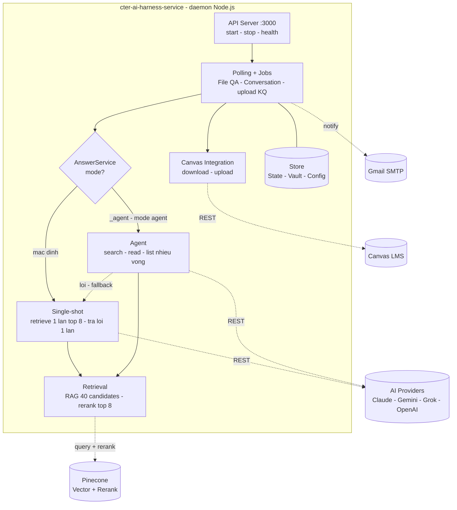
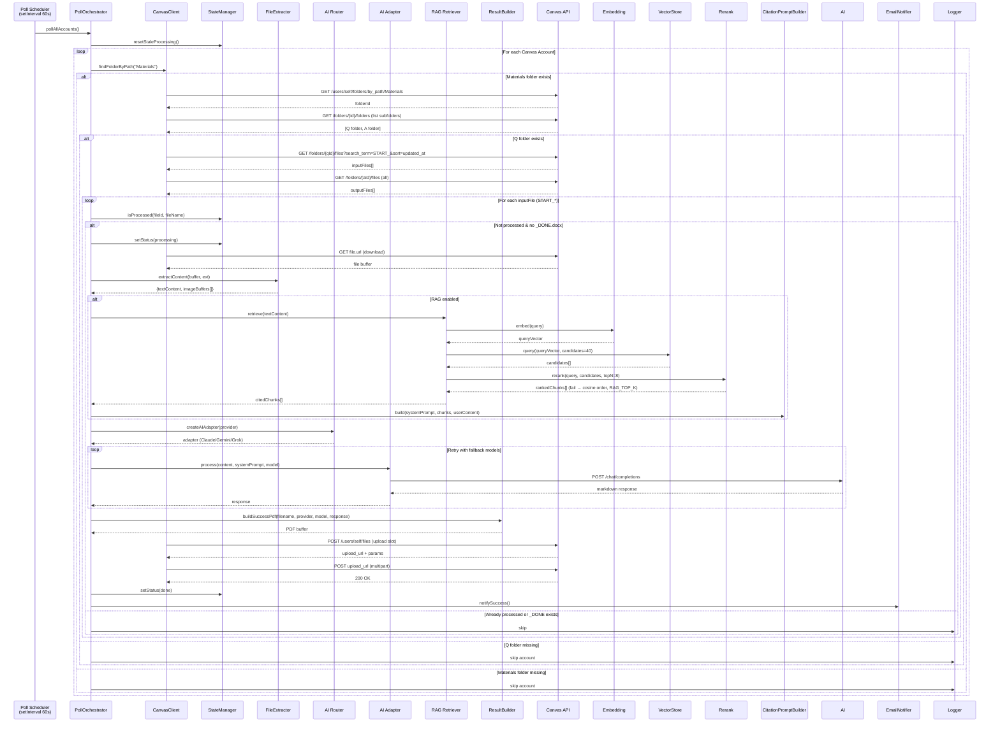
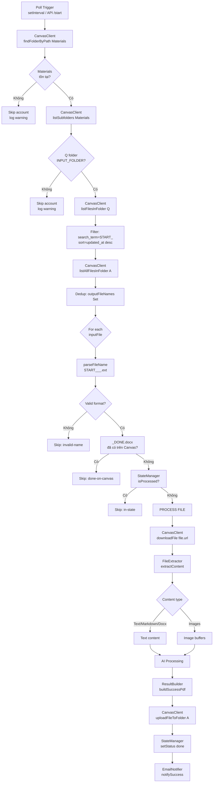
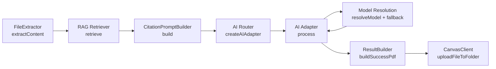
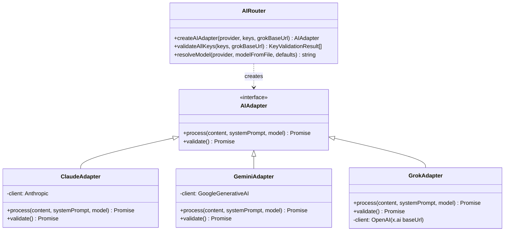
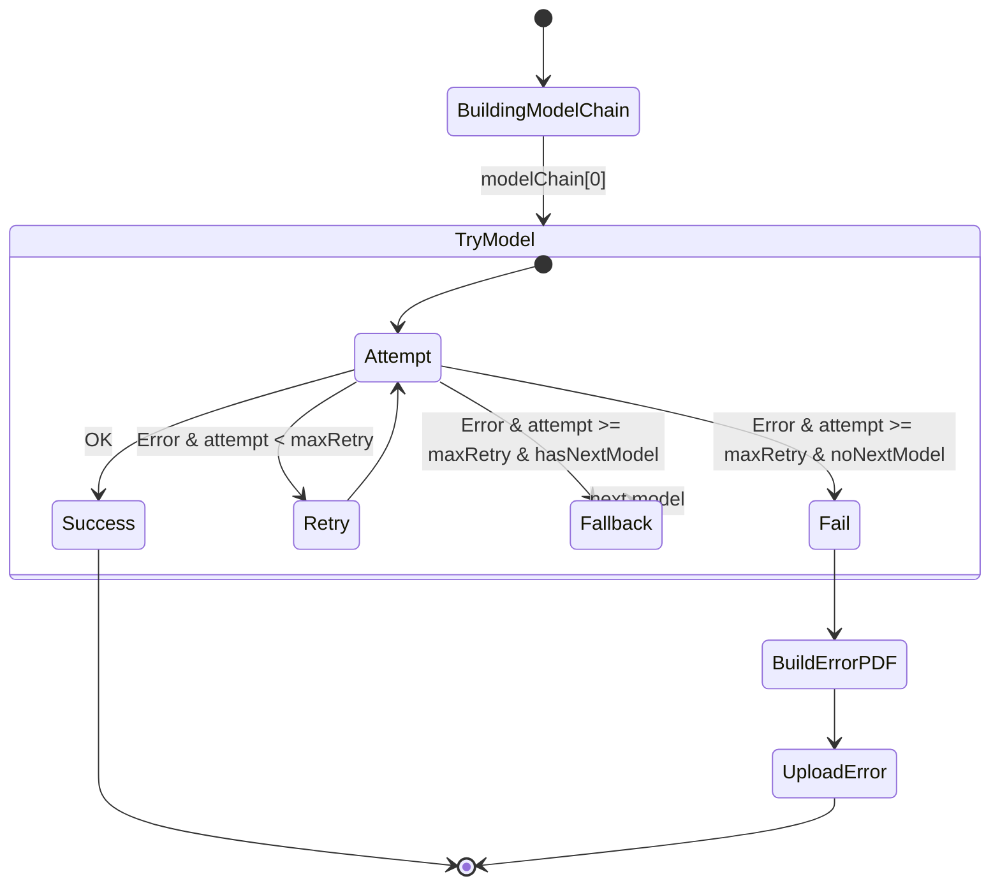
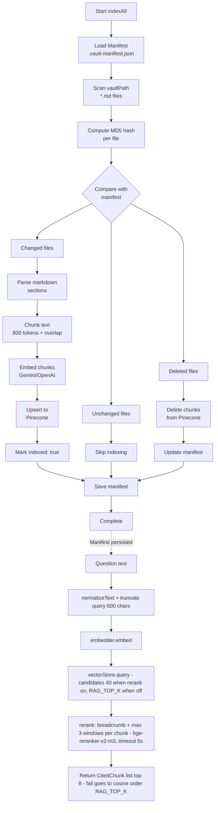
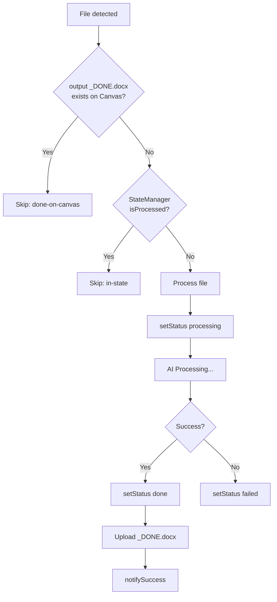
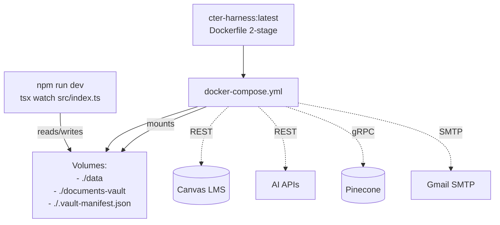

# Kiến trúc hệ thống cter-ai-harness-service

> Document mô tả kiến trúc tổng thể, luồng dữ liệu và cơ chế retrieve từ Canvas.

## 1. Tổng quan kiến trúc

Hệ thống là một **daemon Node.js/TypeScript** chạy nền, thực hiện polling định kỳ đến Canvas, xử lý file qua AI providers, và upload kết quả ngược lại Canvas.



> Chi tiết từng khối xem các mục bên dưới (polling §3, Canvas retrieve §4, AI pipeline §5, RAG + rerank §6).

## 2. Các module chính

| Module | File | Trách nhiệm |
|---|---|---|
| **Entry Point** | `src/index.ts` | Khởi tạo config, state, RAG, orchestrator, API server |
| **Configuration** | `src/bootstrap/config/loadConfig.ts` | Load `.env`, `system-prompt.md`, `knowledge.md`, validate accounts |
| **API Server** | `src/bootstrap/httpServer.ts` | HTTP server port 3000: `GET /`, `/start`, `/stop` điều khiển polling |
| **Orchestrator** | `src/modules/polling/application/pollScheduler.service.ts` | Điều phối vòng lặp poll, xử lý file, retry/fallback logic |
| **Canvas Client** | `src/modules/fileqa/infrastructure/canvasFilesClient.adapter.ts` | Gọi Canvas API: find folder, list files, download, upload |
| **File Extractor** | `src/modules/fileqa/infrastructure/pdfjsFileExtractor.adapter.ts` | Trích xuất text/ảnh từ .txt, .md, .docx, images |
| **AI Router** | `src/modules/ai/infrastructure/aiAdapter.factory.ts` | Factory tạo adapter, validate keys, resolve model |
| **AI Adapters** | `src/modules/ai/infrastructure/providers/*.adapter.ts` | Implement `AIAdapter` interface cho từng provider |
| **RAG Retriever** | `src/modules/retrieval/application/ragRetriever.service.ts` | Retrieve candidates cosine từ Pinecone (inner retriever) |
| **Rerank** | `src/modules/rerank/` | Decorator `RerankingRetriever`: 40 candidates → cross-encoder `bge-reranker-v2-m3` → top 8 (fail → fallback cosine) |
| **Knowledge Indexer** | `src/modules/retrieval/application/knowledgeIndexer.service.ts` | Index vault documents vào Pinecone (incremental) |
| **Vector Store** | `src/modules/retrieval/infrastructure/pineconeVectorStore.adapter.ts` | Wrapper Pinecone: upsert, query, delete |
| **Embedding Service** | `src/modules/retrieval/infrastructure/embedding.factory.ts` | Gemini / OpenAI embedding |
| **Result Builder** | `src/modules/fileqa/infrastructure/pdfResultRenderer.adapter.ts` | Tạo PDF/DOCX kết quả từ markdown AI response |
| **Email Notifier** | `src/modules/notification/infrastructure/gmailNotifier.adapter.ts` | Gửi email success/fail qua Gmail SMTP |
| **State Manager** | `src/shared/state/processingStateStore.ts` | Quản lý `data/processed.json` deduplication |

## 3. Luồng Polling Canvas (Chi tiết)



## 4. Canvas Retrieve Flow (Cách lấy file từ Canvas)



### 4.1 Chi tiết Canvas API calls

| Bước | Endpoint Canvas API | Method | Mục đích |
|---|---|---|---|
| 1 | `/api/v1/users/self/folders/by_path/{path}` | GET | Tìm folder `Materials` theo path |
| 2 | `/api/v1/folders/{id}/folders` | GET | Liệt kê subfolders (tìm Q, A) |
| 3 | `/api/v1/folders/{qId}/files?search_term=START_&sort=updated_at&order=desc` | GET | Lấy file input có prefix `START_` |
| 4 | `/api/v1/folders/{aId}/files` | GET | Lấy tất cả file output để dedup |
| 5 | `{file.url}` | GET | Download nội dung file |
| 6 | `/api/v1/users/self/files` | POST | Request upload slot (target folder A) |
| 7 | `{upload_url}` | POST multipart | Upload file binary đến pre-signed URL |

### 4.2 File naming convention (parseFileName)

```
START_<tên_tự_do>_<provider>[_<model>].<extension>
```

Ví dụ:
- `START_bai_tap_1_claude.txt` → provider=claude, model=default
- `START_cau_hoi_gemini_gemini-2.0-flash.docx` → provider=gemini, model=gemini-2.0-flash

Output file: `<original_name>_DONE.docx`

## 5. AI Processing Pipeline



### 5.1 AI Provider Adapters



### 5.2 Retry & Fallback Logic



## 6. RAG Document Vault Pipeline



### 6.1 Manifest Structure (`.vault-manifest.json`)

```json
{
  "files": {
    "Week-01/Architecture.md": {
      "hash": "cafe8cbe655538b57c8875eefed95550",
      "chunkIds": ["Week-01_Architecture_chunk_000", "..."],
      "indexed": true
    }
  }
}
```

- `hash`: MD5 của nội dung file (sau normalizeText)
- `chunkIds`: IDs của vectors trong Pinecone
- `indexed`: `true` khi tất cả chunks đã upsert thành công

### 6.2 Chunking Strategy

```
CHUNK_MAX_TOKENS = 800
CHUNK_OVERLAP_TOKENS = 100

Markdown → Parse sections (## headings)
      → Chunk by paragraphs
      → Estimate tokens (length/4)
      → Split at ~800 tokens
      → Overlap 100 tokens between chunks
```

### 6.3 Rerank (`src/modules/rerank/`)

Tắt mặc định (`RERANK_PROVIDER=none` → giữ hành vi cosine cũ). Bật bằng `RERANK_PROVIDER=pinecone` (dùng chung `PINECONE_API_KEY`, model `bge-reranker-v2-m3` đa ngôn ngữ cho vault tiếng Việt).

```
Câu hỏi ─► Pinecone top 40 (cosine) ─► breadcrumb "file › heading" + ≤3 cửa sổ chồng 20%/chunk
        ─► bge-reranker-v2-m3 ─► điểm chunk = điểm cửa sổ cao nhất ─► top 8 vào prompt
             │ lỗi / timeout 5s / kết quả rỗng
             └──► fallback thứ tự cosine, cắt RAG_TOP_K (không bao giờ mất câu trả lời)
```

| Khía cạnh | Chi tiết |
|---|---|
| Wiring | `src/index.ts:35,81-82` — `createRerankModule(config.rerank, { pineconeApiKey })` → `ranking.wrap(vectorRetriever, { topN, fallbackTopK, label })` |
| Single-shot | `candidateCount(RAG_TOP_K)` → 40 candidates → `topN=RERANK_TOP_N` (8) → prompt; fail → cosine top `RAG_TOP_K` (20) |
| Agent `search_vault` | `RagVaultSearcher` fetch 40 → rerank giữ top 10 → tool hiển thị 5 (`SEARCH_RESULTS_SHOWN`) |
| Văn bản chấm điểm | `breadcrumbOf(chunk)` (path + parentHeading + heading, khử trùng) + chunk text, cắt `maxDocumentChars=1500`; query cắt `maxQueryChars=600` |
| Giới hạn Pinecone | Tối đa 100 documents/request → `passagesPerChunk = min(3, floor(100/candidates))` |
| Retry | SDK retry tắt (`maxRetries: 0`) — lỗi trả fallback ngay, không nhân tải |
| Kết quả | `CitedChunk.rerankScore?` — điểm cross-encoder của chunk được giữ lại |
| Hiệu quả đo (golden 37 câu) | Hit@1 69,7% → **90,9%**, MRR 0,802 → **0,947**, Hit@8 = 100% |
| Rollback | `RERANK_PROVIDER=none` (không cần deploy lại code) |
| Log | `[rerank] enabled — bge-reranker-v2-m3, 40 candidates → top 8` (startup); `[rerank] single-shot — 40→8 in 1061ms (top1 0.909 …)` / `… failed (…) — using vector order` (mỗi câu) |

## 7. State Management & Deduplication



**State file** (`data/processed.json`):
```json
{
  "fileId:filename:accountIndex": {
    "fileId": "12345",
    "fileName": "START_test_claude.txt",
    "accountIndex": 1,
    "status": "done",
    "retryCount": 0,
    "updatedAt": "2026-08-28T07:00:00.000Z"
  }
}
```

**Stale reset**: file `processing` quá `aiTimeoutMs * (maxRetryCount + 2)` → reset về `pending` để retry lại.

## 8. Deployment Architecture



## 9. Configuration (`.env`)

```env
# Canvas Accounts (có thể nhiều)
CANVAS_URL_1=https://rmit.instructure.com
CANVAS_KEY_1=xxx
CANVAS_EMAIL_1=user@example.com

# AI Providers (ít nhất 1)
CLAUDE_API_KEY=sk-ant-...
GEMINI_API_KEY=...
GROK_API_KEY=...

# Default models
DEFAULT_MODEL_CLAUDE=claude-sonnet-4-6
DEFAULT_MODEL_GEMINI=gemini-2.0-flash
DEFAULT_MODEL_GROK=grok-4.3

# Fallback models (khi model chính fail)
MODEL_FALLBACK_CLAUDE=claude-sonnet-4-6,claude-haiku-4-5-20251001
MODEL_FALLBACK_GEMINI=gemini-2.0-flash,gemini-1.5-pro
MODEL_FALLBACK_GROK=grok-4.3,grok-4-fast-reasoning

# RAG (optional)
PINECONE_API_KEY=pcsk_...
PINECONE_INDEX=canvas-helper
EMBEDDING_PROVIDER=gemini
VAULT_PATH=./documents-vault
RAG_TOP_K=20  # khi rerank off: số chunk vào prompt; khi rerank on: chỉ dùng khi rerank lỗi (fallback)

# Rerank (optional, tắt mặc định)
RERANK_PROVIDER=pinecone  # none = cosine cũ | pinecone = bật rerank (dùng chung PINECONE_API_KEY)
RERANK_MODEL=bge-reranker-v2-m3
RERANK_CANDIDATES=40      # Pinecone top-k fetch trước rerank
RERANK_TOP_N=8            # chunk giữ lại cho prompt single-shot
RERANK_TIMEOUT_MS=5000    # quá hạn → fallback cosine

# Polling
POLL_INTERVAL_MS=60000
AI_TIMEOUT_MS=120000
MAX_RETRY_COUNT=3

# Email (optional)
GMAIL_USER=xxx@gmail.com
GMAIL_APP_PASSWORD=xxx

# Canvas folder names
CANVAS_MATERIALS_FOLDER=Materials2
CANVAS_INPUT_FOLDER=Q
CANVAS_OUTPUT_FOLDER=A
```

## 10. Monitoring & Debugging

```mermaid
flowchart LR
    A[Health Check GET /] --> B{Status}
    B -->|up| C[polling running/stopped]
    B -->|up| D[canvasAccounts[]]
    
    %% Logs
    E[Logs] --> F[fetch/download/extract/ai/upload ok/failed]
    E --> G[WARN skip/reasons]
    E --> H[ERROR fetchError/uploadErrorFailed]
    
    %% State
    I[State File] --> J[data/processed.json]
    K[Manifest] --> L[vault-manifest.json]
```

**Key log patterns:**
- `[INFO] Polling started` / `Polling stopped`
- `[INFO] Fetch account 1: found 3 files`
- `[INFO] Processing START_test_claude.txt with claude/claude-sonnet-4-6`
- `[INFO] OK START_test_claude.txt -> START_test_claude_DONE.docx`
- `[WARN] Skip START_xxx: done-on-canvas / in-state / invalid-name`
- `[ERROR] Failed after all retries: <error message>`

## 11. Cách đọc codebase (không phải MVC)

**Không phải MVC:** Không có Model-View-Controller rõ ràng (không có View — chỉ API JSON, không có Controller lớn). Thay vào đó là **Pipeline + Orchestrator + Modular Services**, phù hợp cho daemon polling.

| Layer | Folder | Vai trò | Đọc khi nào |
|---|---|---|---|
| Config | `src/bootstrap/config/loadConfig.ts`, `src/modules/ai/domain/modelCatalog.ts` | Parse `.env` → `AppConfig` | Đầu tiên |
| State | `src/shared/state/processingStateStore.ts` | `data/processed.json` dedup | Hiểu polling idempotent |
| Canvas | `src/modules/{fileqa,conversation}/infrastructure/*` | Gọi Canvas API folder/file/conversation | Debug API |
| Extractor | `src/extractor/` | `FileContent {text,imageBuffers}` | File parse lỗi |
| AI | `src/modules/ai/` | `aiRouter` + adapters (claude/gemini/grok/openai) | Model fail |
| RAG | `src/modules/retrieval/` | `KnowledgeIndexer` chunk H1/H2 800 tokens → embed → Pinecone; `RAGRetriever` | Vault |
| Rerank | `src/modules/rerank/` | Decorator `RerankingRetriever` bọc `RAGRetriever`: `PineconeReranker` (Inference `/rerank`, retry tắt) + breadcrumb/windows + fallback cosine | Retrieval xếp sai thứ tự |
| Vault | `src/vault/` | `NeonHttpVaultStorage` (Neon HTTP) / `SqliteVaultStorage` fallback — hierarchies `folder_path`/`depth` | Upload/list/delete |
| Orchestrator | `src/modules/polling/application/pollScheduler.service.ts`, `conversationPoller.ts` | `setInterval pollAllAccounts()` | Core flow |
| API | `src/bootstrap/httpServer.ts` | `http.createServer` — `GET /`, `/health`, `/start`/`/stop`, `/api/vault/*`, `GET /docs` Swagger | Deploy/trigger |
| Utils | `src/shared/` | logger, emailNotifier, resultBuilder (PDF/DOCX) | Phụ trợ |

**Entry point:** `src/index.ts:10` `loadConfig() → StateManager → ConversationPoller → PollOrchestrator → ApiServer.start()` (start API trước để Render kịp port, RAG index chạy background).

**Luồng 1 lần poll:** `PollOrchestrator pollAllAccounts` → Canvas list Q → Extractor → RAG retrieve (40 candidates → rerank top 8 khi `RERANK_PROVIDER=pinecone`, fail → cosine `RAG_TOP_K`) → AI Router (citation) → ResultBuilder PDF/DOCX → Canvas upload A → State mark done. `ConversationPoller` chạy song song cho chat.

**Thứ tự đọc cho người mới:** `types.ts` → `config.ts` → `stateManager.ts` → `pollOrchestrator.ts` → `conversationPoller.ts` → `api/server.ts` → `rag/knowledgeIndexer.ts` → `canvas/*` → `ai/*`. Đặt `console.log` ở `pollOrchestrator:processFile()` và chạy `GET /start` để trace.

---

**Liên quan:**
- `docs/sync-and-docker.md` - Đồng bộ vault & Docker commands
- `docs/git-flow.md` - Git workflow
- `docs/docker.md` - Docker guide
- `docs/API_VAULT.md` - Vault API + hierarchies + chunks
- `README.md` - Quick start