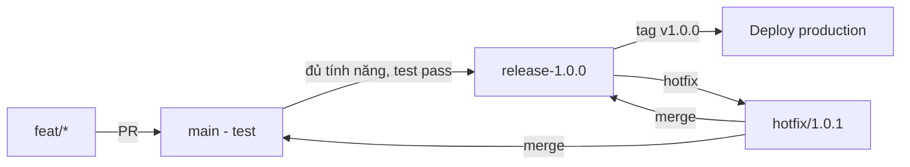

# Git Flow

> Áp dụng cho [cter-ai-harness-service](../../) - môi trường nhỏ, không dùng nhánh `develop`.

## 1. Tổng quan

| Nhánh | Mục đích | Môi trường | Bảo vệ |
|---|---|---|---|
| `main` | Nhánh chính, nhận merge trực tiếp từ feature, môi trường test | Test | Bật, yêu cầu PR |
| `release-x.y.z` | Nhánh phát hành ổn định, cắt từ `main` khi sẵn sàng release | Production/Staging | Bật, chỉ nhận hotfix và cherry-pick từ `main` |

Không sử dụng nhánh `develop`. Mọi feature merge thẳng vào `main`.

## 2. Quy ước đặt tên

| Loại | Mẫu | Ví dụ |
|---|---|---|
| Feature | `feat/<ten-ngan>` | `feat/rag-vault` |
| Fix | `fix/<ten-ngan>` | `fix/canvas-pagination` |
| Release | `release-x.y.z` | `release-1.0.0`, `release-1.1.0` |
| Hotfix | `hotfix/x.y.z` | `hotfix/1.0.1` |
| Tag | `vx.y.z` | `v1.0.0` |

Phiên bản theo SemVer `MAJOR.MINOR.PATCH`.

## 3. Luồng làm việc



### 3.1 Phát triển tính năng

1. Tạo nhánh từ `main`: `git checkout -b feat/ten-tinh-nang main`
2. Commit và đẩy lên remote
3. Tạo PR vào `main`, review và merge (squash hoặc merge commit)
4. Tự động deploy môi trường test từ `main` (nếu có CI)

### 3.2 Tạo release

1. Đảm bảo `main` đã pass test trên môi trường test
2. Cắt nhánh release từ `main`:
   ```bash
   git checkout main
   git pull origin main
   git checkout -b release-1.0.0
   git push origin release-1.0.0
   ```
3. Trên `release-1.0.0` chỉ chỉnh sửa nhỏ: bump version `package.json`, sửa lỗi chặn release, cập nhật `CHANGELOG`
4. Tạo tag:
   ```bash
   git tag -a v1.0.0 -m "release 1.0.0"
   git push origin v1.0.0
   ```
5. Deploy production từ tag `v1.0.0` hoặc nhánh `release-1.0.0`

### 3.3 Hotfix

Khi phát hiện lỗi trên production (`release-1.0.0`):

1. Tạo nhánh từ release:
   ```bash
   git checkout release-1.0.0
   git checkout -b hotfix/1.0.1
   ```
2. Sửa lỗi, tạo PR vào `release-1.0.0`, merge và tag `v1.0.1`
3. Merge ngược lại `main` để không lệch:
   ```bash
   git checkout main
   git merge hotfix/1.0.1
   git push origin main
   ```

## 4. Quy tắc

- `main` luôn deploy được cho môi trường test, không merge code lỗi
- `release-x.y.z` sau khi cắt thì đóng băng tính năng, chỉ nhận fix
- Không commit trực tiếp lên `main` và `release-x.y.z`, luôn qua PR
- Mỗi release có tag `vx.y.z` tương ứng
- Hotfix phải merge cả hai nơi: `release-*` và `main`

## 5. Checklist release

- [ ] `main` pass test `npm run build` và `npm test`
- [ ] Cập nhật `package.json` version `x.y.z`
- [ ] Tạo nhánh `release-x.y.z` từ `main`
- [ ] Tạo tag `vx.y.z`
- [ ] Deploy và smoke test trên production
- [ ] Ghi chú thay đổi vào `CHANGELOG` hoặc release notes trên GitHub

## 6. Ví dụ lịch sử

```bash
main:                feat/a -> feat/b -> merge -> main (test)
release-1.0.0:                          -> branch -> tag v1.0.0 -> deploy
hotfix/1.0.1:                                      -> fix -> merge release-1.0.0 + main
release-1.1.0:       feat/c -> merge -> main -> branch -> tag v1.1.0 -> deploy
```
