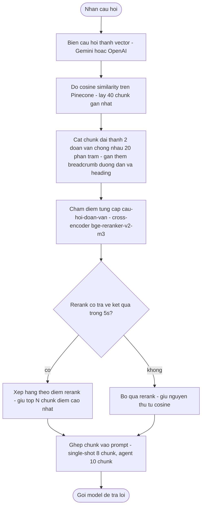
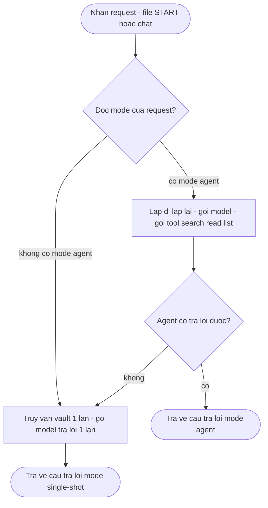
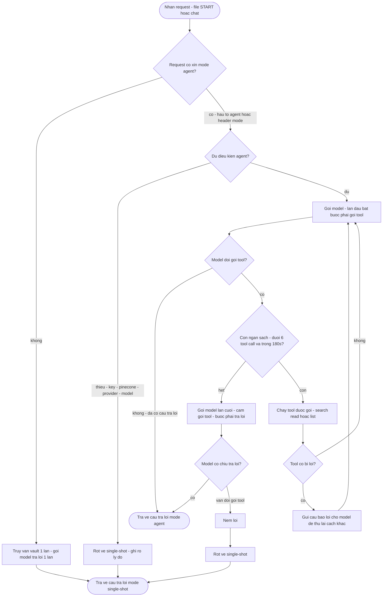

# Retrieval 2 giai đoạn — Dense vector search + Cross-encoder rerank

> Code: `src/modules/retrieval/` (candidate generation) · `src/modules/rerank/` (reranking) · Wiring: `src/index.ts`
> Số liệu: golden 37 câu — Hit@1 69,7% → **90,9%**, MRR 0,802 → **0,947** (chi tiết `CHANGES.md` §2.1).

## Sơ đồ tổng thể

> **Note — Khác biệt cốt lõi giữa 2 giai đoạn:**
> - **Giai đoạn 1 (bi-encoder):** câu hỏi và chunk được biến thành vector **riêng rẽ**, rồi đo góc cosine giữa 2 vector. Nhanh, nhưng model lúc embed chunk không hề biết câu hỏi là gì → chỉ bắt được "na ná nghĩa".
> - **Giai đoạn 2 (cross-encoder `bge-reranker-v2-m3`):** nhét **cả câu hỏi + đoạn văn vào cùng một model transformer**, cho attention chạy chéo giữa từng từ của câu hỏi với từng từ của đoạn văn, rồi output đúng 1 con số: điểm liên quan. Vì nó "đọc" cả hai cùng lúc nên bắt được quan hệ sâu (ví dụ câu hỏi tiếng Anh hỏi về mutex, đoạn văn tiếng Việt viết về mutex nhưng dùng từ khác) mà cosine bỏ sót. Đắt hơn nhiều — nên chỉ chấm 40 ứng viên, không chấm cả vault.

## Ai dùng retrieval

## Luong agent day du - tu request toi tra loi

### Input - output cua tung tool

| Tool | Input | Output |
|---|---|---|
| `search_vault` | `query` (bat buoc - tu khoa can tim), `folder` (tuy chon - chi tim trong thu muc nay) | Toi da 5 doan van, moi doan gom `file - heading - relevance %` + noi dung chunk. Kem `sources` = danh sach file de lam tai lieu trich dan |
| `read_document` | `path` (bat buoc - duong dan file trong vault), `heading` (tuy chon - chi doc 1 section) | Nguyen file, hoac 1 section (tu heading do den heading ngang/hon ke tiep). Path la thi bao "khong co trong vault", heading sai thi tra ve danh sach heading co san. Thanh cong thi file duoc tinh la nguon trich dan |
| `list_folder` | `folder` (tuy chon - bo trong thi liet ke goc vault) | Danh sach thu muc kem so file, hoac danh sach file trong thu muc - toi da 60 dong. Chi de kham pha, **khong** tinh la nguon trich dan |

## Vì sao 2 giai đoạn

| Quan sat tren eval | Ket luan |
|---|---|
| Cosine Hit@10 = 100%, Hit@1 = 69,7% | Tai lieu dung da co mat — van de la xep hang, khong phai recall |
| Rerank thuan Hit@1 = 90,9% vs RRF fusion 81,8% | Chon rerank thuan, loai fusion |
| Vault tieng Viet, cau hoi tieng Anh | Model da ngon ngu xu ly dung ca truot ngon ngu |
| Timeout 5s, SDK retry tat, loi thi fallback cosine | Rerank la toi uu hoa, khong phai dependency |

## Tham số (`RERANK_*` trong `.env`)

| Bien | Mac dinh | Y nghia |
|---|---|---|
| `RERANK_PROVIDER` | `none` | `pinecone` = bat, `none` = cosine cu |
| `RERANK_MODEL` | `bge-reranker-v2-m3` | Cross-encoder da ngon ngu |
| `RERANK_CANDIDATES` | `40` | So ung vien cosine truoc rerank |
| `RERANK_TOP_N` | `8` | Chunk giu lai cho prompt single-shot |
| `RERANK_TIMEOUT_MS` | `5000` | Qua han thi fallback cosine |
